# 03. Workflow State Machine

This document codifies BRD §5.2 (To-Be workflow) as an explicit state machine. Workflow-service enforces every rule below.

## States

| State | Description | Terminal? |
|---|---|---|
| `DRAFT` | Office user is filling in details and uploading attachments | No |
| `SUBMITTED` | Office submitted, awaiting initial verification | No |
| `INITIAL_VERIFICATION` | With FAD Senior Administrator | No |
| `FINAL_VERIFICATION` | With FAD Senior Officer | No |
| `DIRECTOR_REVIEW` | With FAD Director | No |
| `TYPIST_PROCESSING` | Director approved; Typist preparing embassy applications | No |
| `WAITING_FOR_EMBASSY` | Embassy applications submitted; awaiting visas | No |
| `WAITING_FINAL_REVIEW` | All visas uploaded; Senior Officer closing | No |
| `COMPLETED` | Success | **Yes** |
| `RETURNED_TO_OFFICE` | Sent back for correction | No (re-enters SUBMITTED) |
| `APOLOGIZED` | Director closed with apology | **Yes** |
| `REJECTED` | Outright rejection (reserved terminal status; no transition currently targets it) | **Yes** |

## Transition table

The table below is the source of truth. Workflow-service has it in code (`workflow-state-machine.ts`); changes here must be reflected there with a test.

| From | Action | To | Allowed Personas | Preconditions |
|---|---|---|---|---|
| `DRAFT` | `SUBMIT` | `SUBMITTED` | OFFICE, SENIOR_ADMIN¹ | Required docs uploaded; attachment counts match beneficiary count |
| `SUBMITTED` | `START_INITIAL_VERIFY` | `INITIAL_VERIFICATION` | SENIOR_ADMIN | Self-assigns |
| `INITIAL_VERIFICATION` | `VERIFY_OK` | `FINAL_VERIFICATION` | SENIOR_ADMIN | Current assignee |
| `INITIAL_VERIFICATION` | `RETURN_TO_OFFICE` | `RETURNED_TO_OFFICE` | SENIOR_ADMIN | Current assignee; comment required |
| `FINAL_VERIFICATION` | `VERIFY_OK` | `DIRECTOR_REVIEW` | SENIOR_OFFICER | Embassy Letter attached |
| `FINAL_VERIFICATION` | `RETURN_TO_OFFICE` | `RETURNED_TO_OFFICE` | SENIOR_OFFICER | Current assignee; comment required |
| `DIRECTOR_REVIEW` | `APPROVE` | `TYPIST_PROCESSING` | DIRECTOR | Assigns to Typist team |
| `DIRECTOR_REVIEW` | `RETURN_FOR_CORRECTION` | `FINAL_VERIFICATION` | DIRECTOR | Comment required |
| `DIRECTOR_REVIEW` | `APOLOGIZE` | `APOLOGIZED` | DIRECTOR | Comment required; sends email to office |
| `TYPIST_PROCESSING` | `SEND_TO_EMBASSY` | `WAITING_FOR_EMBASSY` | TYPIST | All Visa Applications uploaded; appointments scheduled; fees set |
| `WAITING_FOR_EMBASSY` | `UPLOAD_VISAS` | `WAITING_FINAL_REVIEW` | OFFICE, TYPIST² | Visa documents match beneficiary count |
| `WAITING_FOR_EMBASSY` | `REASSIGN_TO_SELF` | `WAITING_FOR_EMBASSY` | TYPIST | Optional: Typist takes over uploading visas (BRD §5.2 last bullet) |
| `WAITING_FINAL_REVIEW` | `COMPLETE` | `COMPLETED` | SENIOR_OFFICER | All visas present |
| `RETURNED_TO_OFFICE` | `RESUBMIT` | `SUBMITTED` | OFFICE, SENIOR_ADMIN | Documents updated |

¹ Senior Admin can create on behalf of Office per BRD §5.2.
² Typist can take over per BRD §5.2 last paragraph.

## State diagram

```mermaid
stateDiagram-v2
    [*] --> DRAFT
    DRAFT --> SUBMITTED: SUBMIT (Office / Sr.Admin)
    SUBMITTED --> INITIAL_VERIFICATION: START_INITIAL_VERIFY (Sr.Admin)
    INITIAL_VERIFICATION --> FINAL_VERIFICATION: VERIFY_OK
    INITIAL_VERIFICATION --> RETURNED_TO_OFFICE: RETURN_TO_OFFICE
    FINAL_VERIFICATION --> DIRECTOR_REVIEW: VERIFY_OK (Sr.Officer)
    FINAL_VERIFICATION --> RETURNED_TO_OFFICE: RETURN_TO_OFFICE
    DIRECTOR_REVIEW --> TYPIST_PROCESSING: APPROVE
    DIRECTOR_REVIEW --> FINAL_VERIFICATION: RETURN_FOR_CORRECTION
    DIRECTOR_REVIEW --> APOLOGIZED: APOLOGIZE
    TYPIST_PROCESSING --> WAITING_FOR_EMBASSY: SEND_TO_EMBASSY
    WAITING_FOR_EMBASSY --> WAITING_FINAL_REVIEW: UPLOAD_VISAS
    WAITING_FINAL_REVIEW --> COMPLETED: COMPLETE (Sr.Officer)
    RETURNED_TO_OFFICE --> SUBMITTED: RESUBMIT
    COMPLETED --> [*]
    APOLOGIZED --> [*]
    REJECTED --> [*]
```



## Document requirements per transition

| Transition | Required Documents |
|---|---|
| `SUBMIT` (DRAFT→SUBMITTED) | 1× OFFICE_LETTER, N× BENEFICIARY_ATTACHMENT (where N = beneficiary count), N× EMBASSY_VISA_FORM |
| `VERIFY_OK` (FINAL_VERIFICATION→DIRECTOR_REVIEW) | 1× EMBASSY_LETTER (system-generated in Phase 2; manually attached in Phase 1) |
| `SEND_TO_EMBASSY` | N× VISA_APPLICATION; appointment scheduled per beneficiary; fees set |
| `UPLOAD_VISAS` | N× VISA |

These are validated by document-service via `POST /documents/validate-counts` before workflow-service permits the transition.

## Notification triggers

The BRD §5.2 "Actions" button lets actors send emails on certain transitions. The system also auto-sends notifications:

| Transition | Auto-email To | Auto in-app to |
|---|---|---|
| `SUBMIT` | — | Senior Admin team |
| `RETURN_TO_OFFICE` (any) | Office (CC Senior Admin) | Office user |
| `VERIFY_OK` (FINAL_VERIFICATION→DIRECTOR_REVIEW) | — | Director |
| `APPROVE` | Office, Sr.Admin, Sr.Officer, Typist team | Typist team |
| `APOLOGIZE` | Office (CC Sr.Admin, Sr.Officer) | Office user |
| `SEND_TO_EMBASSY` | Office (with beneficiary appointment list), Embassy (separate email) | Office user |
| `COMPLETE` | Office | Office user |

For all of these, the actor can override To/CC/Subject/Body via the "Actions" UI (BRD requirement).

## Implementation note

The state machine is implemented as a pure function:

```typescript
function executeTransition(
  current: RequestStatus,
  action: WorkflowAction,
  actorPersonas: PersonaCode[],
  context: TransitionContext
): TransitionResult { ... }
```

This makes it trivially unit-testable. See `services/workflow-service/src/state-machine.ts` and its companion `state-machine.spec.ts` for 30+ test cases covering every transition + every illegal transition.
